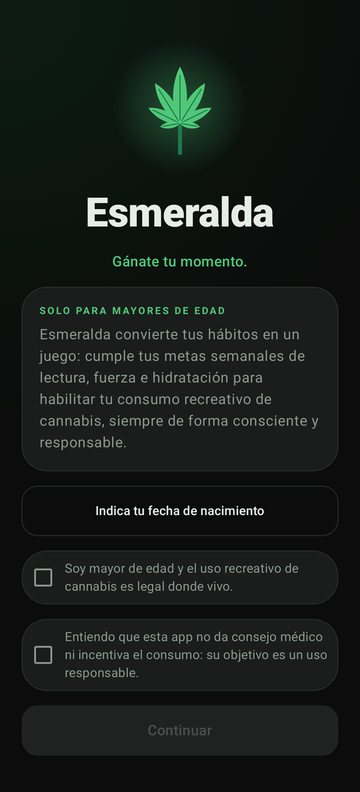
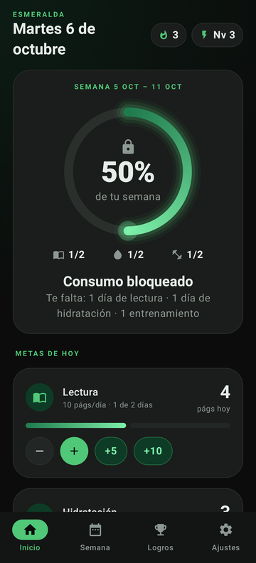
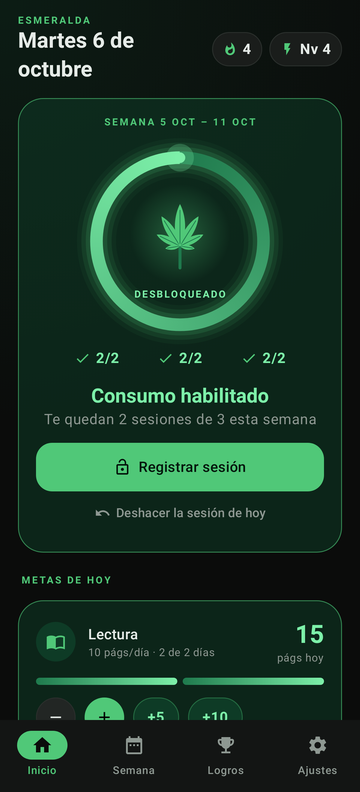
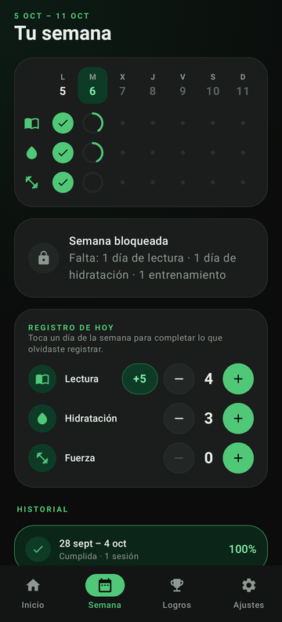
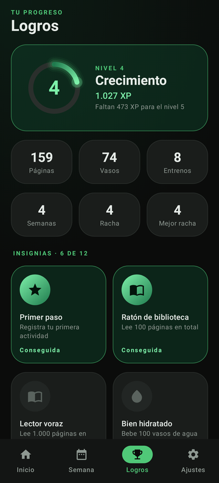
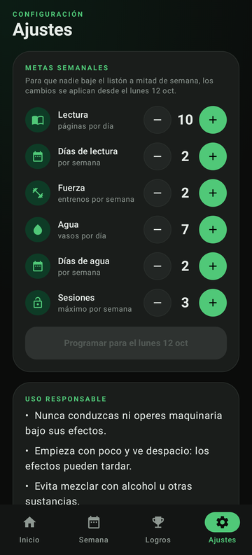

# Esmeralda

App Android que convierte en un juego el uso **recreativo y responsable** de cannabis
para **personas adultas**: el consumo de la semana se desbloquea solo cuando cumples
tus metas de lectura, fuerza e hidratación.

Negro mate y verde esmeralda. Kotlin + Jetpack Compose, compilada contra
**Android 16 (API 36)**.

| Bienvenida | Bloqueado | Desbloqueado |
|---|---|---|
|  |  |  |

| Semana | Logros | Ajustes |
|---|---|---|
|  |  |  |

## Cómo funciona

Cada semana (de lunes a domingo) hay que cumplir **todas** estas metas para
habilitar el consumo. Los valores por defecto son:

| Meta | Por defecto | Cuenta como cumplida cuando… |
|---|---|---|
| Lectura | 10 páginas/día, 2 días | hay 2 días con al menos 10 páginas |
| Fuerza | 2 entrenamientos/semana | se acumulan 2 entrenamientos en la semana |
| Hidratación | 7 vasos/día, 2 días | hay 2 días con al menos 7 vasos |

- Al cumplirlas, el anillo se completa, aparece la hoja y se habilita
  **Registrar sesión**, con un tope semanal (3 por defecto). Antes de registrar,
  la app recuerda pautas de uso responsable.
- Si lo cumples todo en los **dos primeros días** (lunes y martes) ganas la
  insignia *Disciplina*.
- Puedes completar días anteriores de la semana en curso desde **Semana**, pero no
  días futuros ni semanas pasadas.
- **Sin trampas:** los cambios de metas se programan para el lunes siguiente;
  la semana en curso mantiene las metas con las que empezó.

### Gamificación

- **XP:** 1 por página, 2 por vaso, 20 por entrenamiento, +10 por cada meta diaria
  cumplida y +100 por semana desbloqueada.
- **Niveles** con nombres de etapas de cultivo: Semilla, Germinado, Plántula,
  Crecimiento, Prefloración, Floración, Cosecha y Maestro Esmeralda.
- **Rachas** de semanas cumplidas seguidas (la semana en curso nunca rompe la racha).
- **12 insignias**, entre ellas *Pausa consciente*, por cumplir una semana entera
  sin registrar sesiones.
- Confeti, vibración y aviso al desbloquear la semana, subir de nivel o ganar una
  insignia.
- Afirmación del día y un consejo de uso responsable en la pantalla de inicio.

### Mayoría de edad y privacidad

- Al abrir la app por primera vez se pide la fecha de nacimiento (mínimo 18 años)
  y confirmar que el uso recreativo es legal donde vive la persona. La fecha no se
  guarda: solo se guarda que la verificación se superó.
- Todo se guarda en el dispositivo (DataStore). La copia de seguridad en la nube y
  la transferencia entre dispositivos están desactivadas.
- **Ajustes → Borrar todos los datos** reinicia la app por completo.

> Esta app no vende ni facilita sustancias, no promueve el consumo y no sustituye
> el consejo médico.

## Compilar

Requisitos: JDK 17 o superior y el Android SDK con `platforms;android-36`.

```bash
echo "sdk.dir=/ruta/a/android-sdk" > local.properties   # o define ANDROID_HOME
./gradlew assembleDebug          # APK en app/build/outputs/apk/debug/
./gradlew testDebugUnitTest      # tests de las reglas del juego
./gradlew installDebug           # instala en un dispositivo o emulador conectado
```

También se puede abrir la carpeta en Android Studio.

| | |
|---|---|
| `compileSdk` / `targetSdk` | 36 (Android 16) |
| `minSdk` | 26 (Android 8.0) |
| Gradle / AGP / Kotlin | 9.8.0 / 9.4.1 / 2.4.20 |
| UI | Jetpack Compose (BOM 2026.06.01) + Material 3 |

Las dependencias están fijadas a las últimas versiones que todavía compilan contra
API 36: core 1.19, lifecycle 2.11 y Compose 1.12 ya exigen `compileSdk` 37.

## Estructura

```
app/src/main/java/com/pablovillamed/esmeralda/
├── MainActivity.kt          navegación inferior y celebraciones
├── data/                    modelos serializables y persistencia (DataStore + JSON)
├── domain/                  reglas del juego, sin dependencias de Android
│   ├── GameEngine.kt        semanas, desbloqueo, XP, niveles, rachas, insignias
│   ├── Actions.kt           cambios de estado permitidos
│   ├── Badges.kt
│   └── Content.kt           afirmaciones y consejos de uso responsable
└── ui/
    ├── MainViewModel.kt
    ├── theme/               paleta negro mate + esmeralda
    ├── components/          anillo de progreso, hoja, confeti, tarjetas
    └── screens/             bienvenida, inicio, semana, logros, ajustes
```

Las reglas viven en `domain/` como funciones puras sobre el estado guardado, y están
cubiertas por `app/src/test/.../GameEngineTest.kt`.
