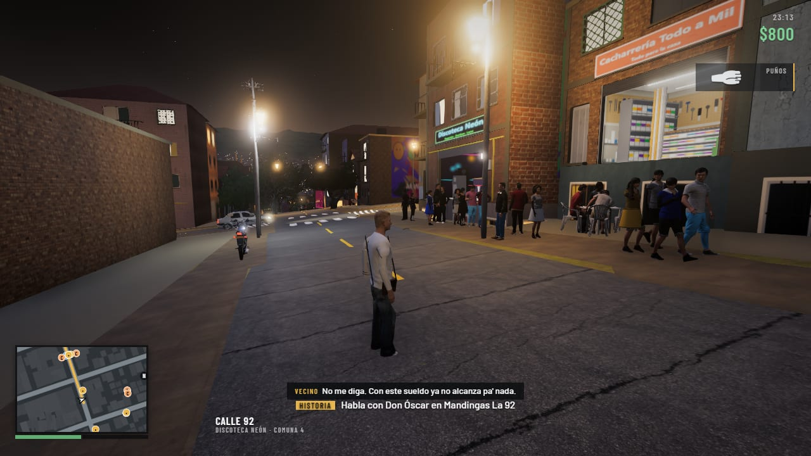
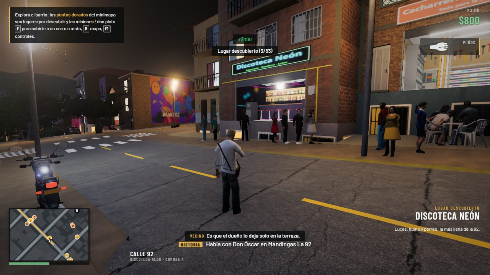
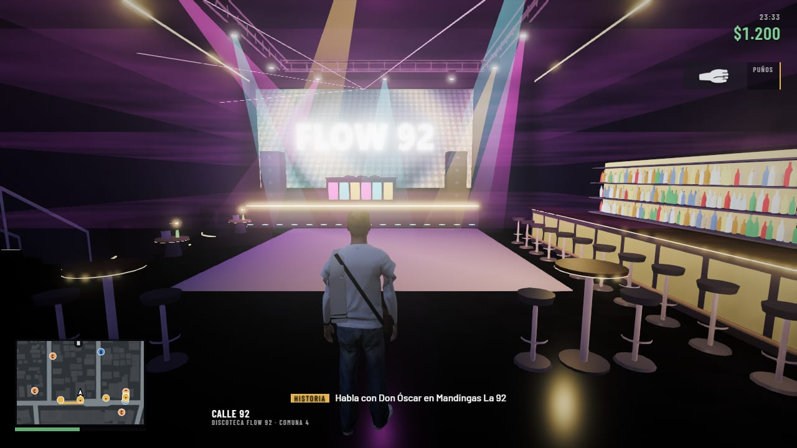
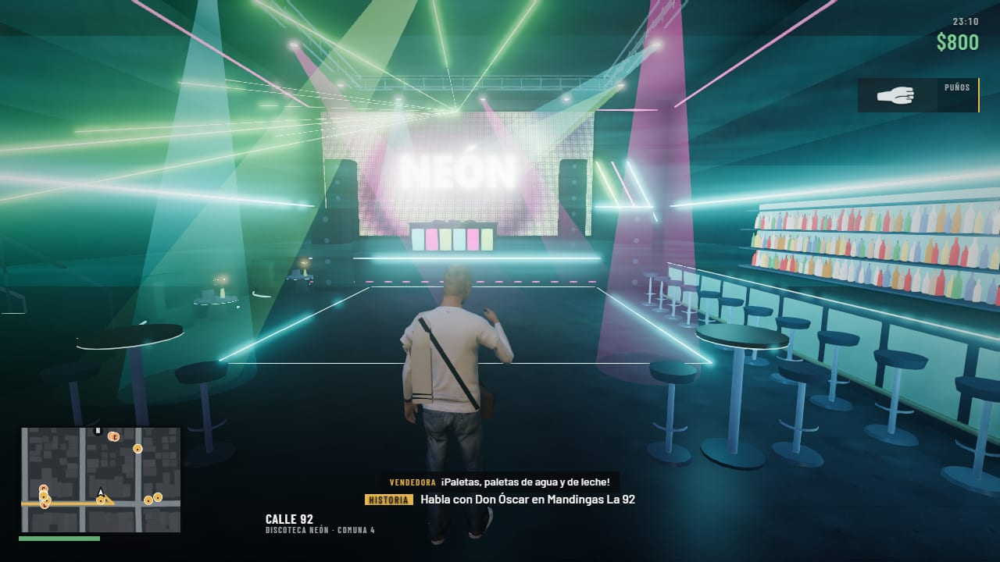
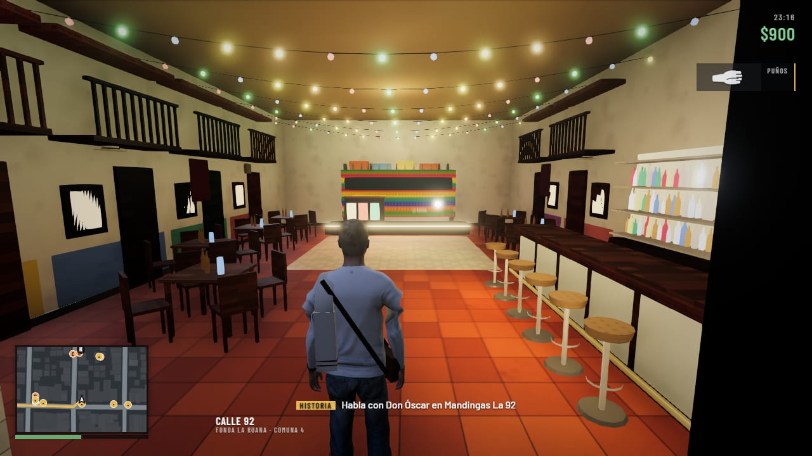
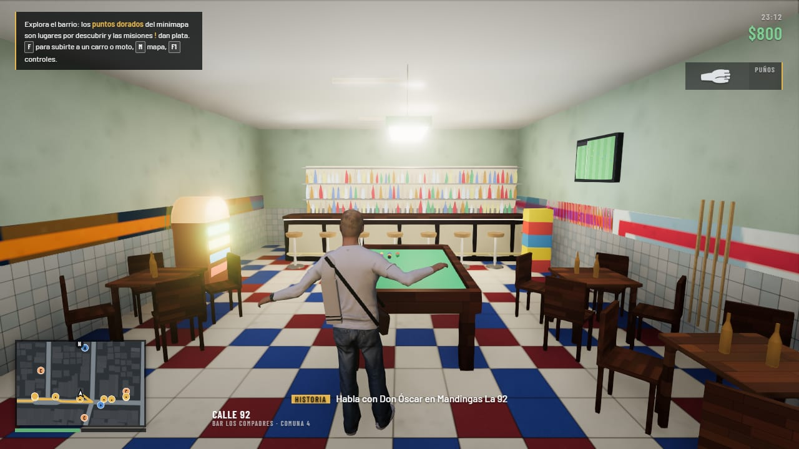
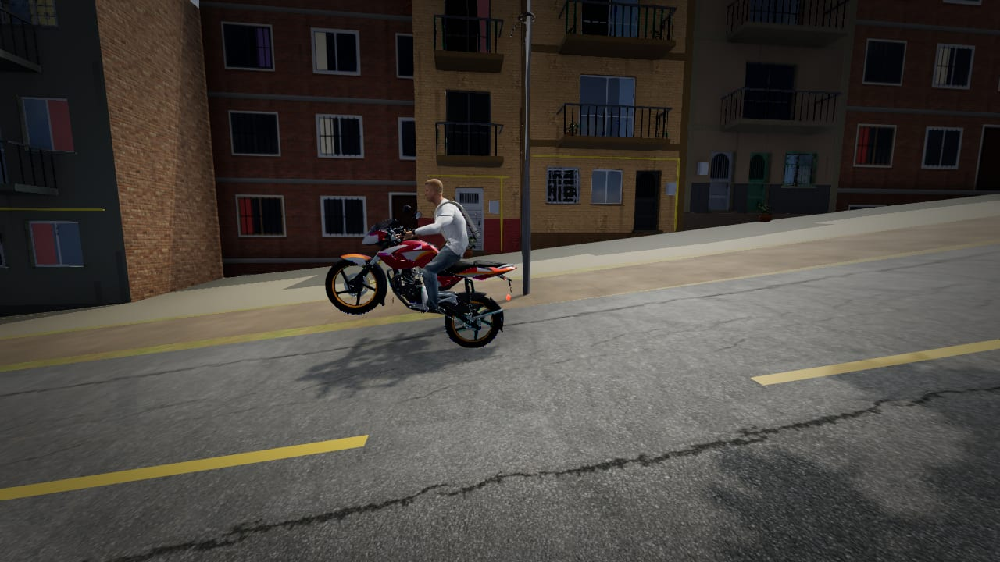
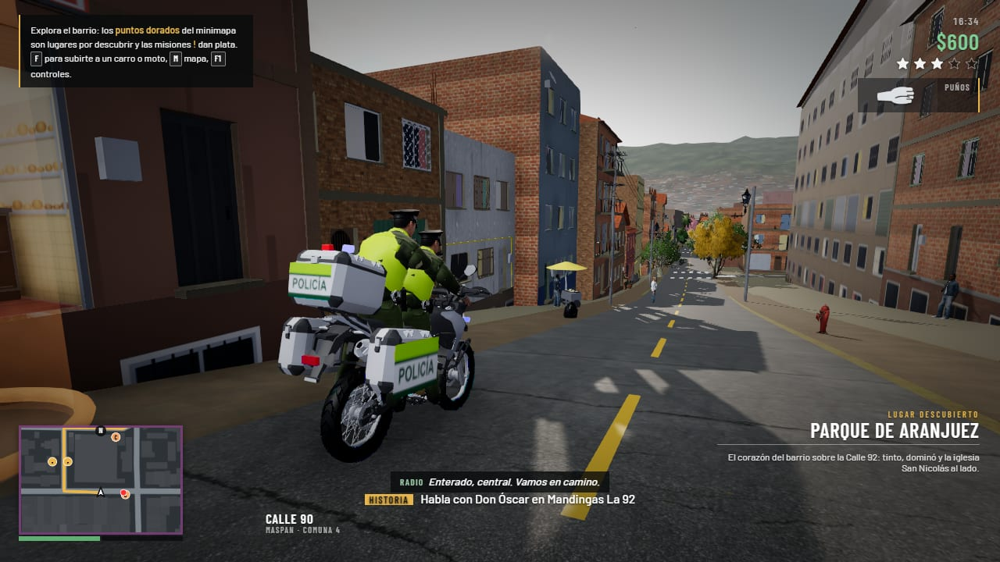
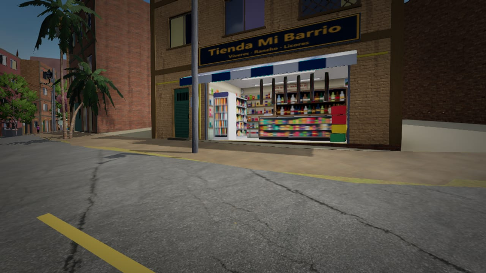
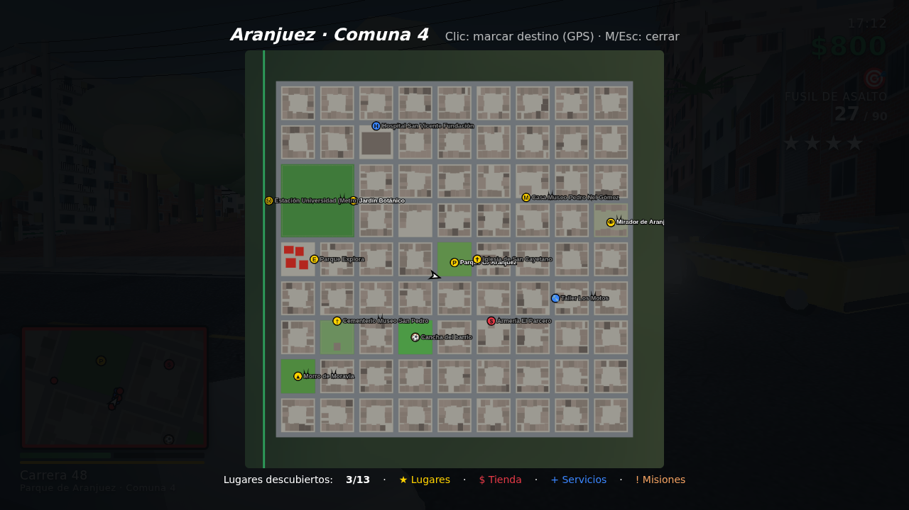

# Medellín: Aranjuez

Juego de mundo abierto en tercera persona inspirado en el barrio **Aranjuez (Comuna 4, Medellín)**. Es un **juego web**: corre en el navegador (Three.js sobre WebGL 2), con teclado y ratón, mando o pantalla táctil; se puede **instalar como app** desde Chrome o Edge y, después de la primera carga, abre sin conexión. La **app de Windows** (Electron) sigue como alternativa para quien prefiera un ejecutable.

> El barrio es una recreación libre, no un plano exacto. El mundo (terreno, calles, manzanas, fachadas, techos, cables y metro) se arma por código al arrancar; encima van recursos de verdad: personajes y animaciones glTF de Microsoft Rocketbox, vehículos, armas, utilería y vegetación en glTF, texturas fotográficas PBR, un cielo HDRI, sonidos grabados (armas y motores), voces sintetizadas y música con licencia libre. Son ~83 MB en `public/`; fuentes y licencias en [ASSETS-CREDITS.md](ASSETS-CREDITS.md).

## Capturas (del juego corriendo)

| | |
|---|---|
|  |  |
|  |  |
|  |  |
|  |  |
|  |  |

Capturas del juego en una GPU real (calidad Alta, versiones 3.5 a 3.7): la 92 de noche con su rumba, el adentro de las discotecas, el caballito, la Policía en moto y las casas asentadas en la loma. Las capturas anteriores (menú, armas, taxi, persecución) siguen en `docs/capturas/` y se regeneran con `npm run shots`.

## Qué incluye el MVP

| Área | Contenido |
|---|---|
| **Mundo** | Ladera de ~630 × 630 m con calles empinadas (hasta 21 %), 81 manzanas y ~1.300 edificaciones: ladrillo a la vista, casas pintadas, locales con persiana, torres, terrazas con tanques de agua y varillas, balcones con reja, murales, postes con cableado aéreo, faroles y guayacanes. De fondo, el valle de Aburrá con miles de casas que se encienden de noche y el río Medellín. |
| **Horizonte del valle** | Las montañas que rodean Medellín hasta ~34 km, con alturas reales: la cordillera occidental (~2.700-3.000 m, Padre Amaya), la ladera oriental que sube a Santo Domingo y Arví, El Volador, Nutibara y el Quitasol al norte. Lomos y cañadas bajando al río, bosque y potrero, la ciudad trepando por las laderas y, de noche, el valle entero lleno de luces. Paralaje y oclusión correctos desde cualquier punto sin alargar la distancia de dibujo. |
| **Geografía real** | El orden de los lugares y los nombres de las vías salen de OpenStreetMap y el perfil del terreno de la elevación SRTM: Parque de Aranjuez sobre la Calle 92 (noreste), Casa Museo Pedro Nel Gómez en el centro, Moravia al oeste de la Carrera 52 (Carabobo) con su autoconstrucción en ladrillo, Explora y Botánico junto a la estación Universidad (Calle 73), Cementerio San Pedro y Hospital San Vicente al sur, y la ladera que sube hacia Manrique (Carrera 45). El mapa comprime ~1,7 × 2,5 km en 9 × 9 manzanas. |
| **Puntos de interés (13)** | Parque de Aranjuez, Iglesia San Nicolás, Casa Museo Pedro Nel Gómez, Jardín Botánico (con Orquideorama), Parque Explora, Estación Universidad del Metro (con tren en movimiento), Hospital San Vicente, Cementerio Museo San Pedro, Morro de Moravia, cancha del barrio, Mirador, Armería y Taller. Descubrir cada uno paga $100. |
| **Fachadas modeladas** | Cada casa tiene su propia fachada según su ancho y pisos: ventanas con marco de aluminio, vidrio reflectivo, alféizar, rejas (barrotes, rombos, abanico, cuadrícula) y cortinas; puerta aparte para subir al segundo piso, garajes y puertas metálicas; vigas y columnas de concreto a la vista, zócalo enchapado o pintado a dos tonos, tubería amarilla del gas, parabólicas, aleros de zinc, balcones con ropa colgada. Las culatas quedan en ladrillo a la vista. De noche se encienden ventanas una por una. Cada edificación se asienta en la loma: puertas, vitrinas y cortinas a la altura del andén, escalas de concreto donde la entrada queda alta, fachadas escalonadas por tramos cuando la calle baja mucho, y zócalo o muro de contención propio (sin la textura de la fachada) en el lado de abajo. |
| **Tiendas y calle** | Locales con cortina metálica a medio subir y el interior armado según el negocio, que se ve desde la calle: tienda de barrio (mostrador con vitrina de dulces, tiras de mecato colgadas, canastas de cerveza, nevera encendida, "Hoy no fío, mañana sí"), panadería, droguería (cruz verde), carnicería, frutería, barbería (sillas y espejos), ferretería, papelería (fotocopiadora), heladería, cafetería, billares (mesa con lámpara) y almacenes de ropa (maniquíes y percheros); piso de baldosa roja, granito o ajedrez y tubos fluorescentes que alumbran de noche. De lejos queda el cuarto pintado (sin utilería 3D). Vecinos sentados en sillas plásticas, venteros (minutos, frutas, mango biche, arepas, helados, dulces), placas de nomenclatura en las esquinas, paraderos y motos parqueadas en los andenes. |
| **Ropa paisa** | El jugador arranca de paisa de ciudad: camisa blanca de manga larga, jean, tenis blancos, poncho al hombro y carriel. Tres almacenes de vestimenta paisa (Almacén El Arriero en la 92, Talabartería Jericó en Carabobo y Artesanías La Silletera junto al parque) venden sombrero aguadeño, poncho blanco o de rayas, carriel de cuero, alpargatas de fique, camisa de arriero y pantalón de dril. Otros cinco almacenes en la 92 y en Carabobo (Almacén Moda Paisa, Boutique Estilo La 92, Remates Carabobo, Deportes La Cancha, Gorras y Tenis La 52) venden gorras planas y curvas, busos con capota, camisetas (verdiblanca y roja de fútbol, sin escudos), jeans, sudaderas, tenis, chanclas con medias, cadena, canguro terciado y gafas. Lo comprado se ve en el personaje (recoloreado de la ropa y mallas pegadas a los huesos), se puede poner y quitar en cualquier almacén y queda en el guardado. |
| **Radio y música** | Al subirse a un carro o una moto suena la radio, como en GTA: cuatro emisoras inventadas con música libre de derechos (CC BY): **La Sabrosa 92.4** (salsa, cumbia, merengue), **Perreo FM 100.6** (reguetón y dancehall), **Parce Radio 97.8** (guaracha, moombahton y electrónica) y **Chill Comuna 4 88.2** (lo-fi). <kbd>Q</kbd> / <kbd>Z</kbd> (cruceta ← → en el mando) cambian de emisora o la apagan; la elección se recuerda. Cada emisora va "en vivo" (al volver no arranca de cero), cada pista muestra título, artista y licencia, la música baja sola cuando alguien habla o hay una cinemática, se pausa con el juego y calla en los menús, y tiene su propio volumen en Configuración. Billares, fritangas y algunas tiendas y mesas de dominó tienen un parlante que se oye bajito de cerca (máximo dos a la vez). Autores y licencias en [ASSETS-CREDITS.md](ASSETS-CREDITS.md#música-de-la-radio) y en la pantalla de créditos. |
| **Sonido del barrio** | Disparos grabados con eco de la calle y motores con explosiones grabadas (síntesis granular, con cambios); sintetizado en vivo: cumbia saliendo de la tienda más cercana, pájaros de día, grillos de noche, perros a lo lejos, campanas de la iglesia cada hora, pito, sirena y chirrido de llantas. |
| **Movilidad a pie** | Caminar, trotar, correr con estamina, agacharse, saltar, subir andenes y pendientes, colisiones sin atravesar paredes aunque el framerate caiga. |
| **Animaciones** | 75 clips de captura de movimiento de Microsoft Rocketbox (MIT, mismo esqueleto que los personajes): para subirse al carro el personaje camina a la puerta, la abre, se sienta de lado y se desliza al puesto (y al bajarse se levanta por la puerta; en moto pasa la pierna por encima), todo adelantable acelerando o caminando; al comprar recibe lo pedido y se lo come o se lo toma (con vaso en la mano); herido cojea; quieto un rato mira alrededor, se rasca o bosteza; <kbd>G</kbd> saluda, celebra, aplaude o baila. En la calle: vecinos sentados que gesticulan cuando hablan y asienten cuando escuchan, peatones con el celular (llamando o escribiendo), venteros que llaman con la mano, pandilleros que caminan sobrados y rumberos de noche. Cada peatón tiene su propia forma de estar quieto, gira en el sitio dando pasos (sin patinar), se inclina en las curvas al correr y voltea la cabeza para mirarte cuando pasas cerca. |
| **Vida de barrio** | Cerca del jugador aparece gente haciendo lo de todos los días: señoras colgando la ropa en el balcón (sacan la prenda del platón y la cuelgan en la cuerda), vecinos fumando recostados a la fachada (cigarrillo con brasa que se ve de noche y bocanadas de humo) o hablando por celular junto a la puerta, gente barriendo el andén, cuatro jugando dominó en una mesa plástica frente a la tienda, el que lava la moto con balde y trapo, y el **picadito**: en las canchas (con arquero), en las placas con arquitos y en calles residenciales tranquilas con piedras de arco, con balón que rebota y rueda, pases, remates, goles celebrados y la pausa para dejar pasar los carros; al jugador también le dejan patear el balón. Todos se asustan con los disparos y salen corriendo (la del balcón se entra a la casa). Solo se ponen en escena los más cercanos, con un cupo de personas por calidad. |
| **Vehículos (6 tipos)** | Taxi amarillo, sedán, camioneta, buseta, patrulla de la Policía y moto (siete variantes de moto, más la de la Policía). Física de aceleración, frenado, reversa, freno de mano con derrape, pendientes, choques con daño, fuego y explosión. Se pueden robar con el conductor adentro. El agarre es limitado: a alta velocidad el carro subvira, los derrapes conservan el impulso y se corrigen con contravolante, el freno de mano suelta la cola, la carrocería cabecea y se balancea en las curvas, y quedan marcas de llanta y humo. Los vehículos aguantan más que antes: chocar en carro no le quita vida al jugador y en moto le quita poca (solo un golpe de frente muy fuerte lo tumba). En moto la moto y el piloto se inclinan en las curvas, el piloto se agacha a fondo y pone el pie en el piso al parar; <kbd>Shift</kbd> + <kbd>W</kbd> hace el caballito y <kbd>Shift</kbd> + <kbd>S</kbd> el stoppie (botón «Caballito» en la pantalla táctil). Subir y bajar es una animación continua: el personaje camina a la puerta girando, se sienta (en moto pasa la pierna por detrás) y la cámara acompaña sin saltos. En moto la inclinación es moderada (~15°), el manubrio vuelve solo al centro y a alta velocidad gira menos; al montarse, el pie de apoyo pisa el estribo y la otra pierna pasa por encima de la parte de atrás del sillín. Al que va en moto se le puede disparar: si muere o queda grave se cae y la moto sin piloto se va al piso. |
| **Armas (6)** | Puños, machete, pistola 9 mm (Beretta 92), subametralladora (HK MP5), escopeta (Remington 870) y fusil (M4A1): modelos reales con texturas PBR, sostenidos con las dos manos. Se empieza con machete, pistola y subametralladora. Selección con 1–6, rueda del ratón o rueda de armas (Tab, con cámara lenta). Cargador, reserva, recarga, dispersión, retroceso, disparos a la cabeza y disparos desde el vehículo. En primera persona siempre se ven las manos y el arma: sube a la mira al apuntar, se mece al caminar, patea al disparar y se recoge contra las paredes. |
| **NPCs** | Peatones que caminan por los andenes, cruzan en las esquinas y huyen de los disparos; tráfico que respeta el carril derecho y frena ante obstáculos; policía que te busca de verdad (ver abajo); pandilla hostil en misión. Tienen rutas de verdad (A* sobre un grafo de andenes, cruces, senderos y parques): van a casas y tiendas, huyen por la calle en vez de contra la pared y rodean la manzana. |
| **Policía** | Solo sabe dónde estás si un agente te ve (línea de vista: 85 m desde la patrulla, 65 m a pie; de cerca te oyen) o si alguien reporta un delito. Persigue por la ruta más corta; si te pierde, acude a tu última posición conocida y barre la **zona de búsqueda** (círculo rojo/azul en el minimapa, que crece y se corre hacia donde ibas) repartiéndose las calles entre patrullas; algunos agentes se bajan a buscarte a pie. Escondido dentro de la zona las estrellas bajan más lento que fuera de ella. Los refuerzos llegan escalonados (con 3 estrellas, a los 5, 14 y 23 s) y hay un tope de unidades por nivel (1 a 5): unas persiguen, otras cortan el paso más adelante y otras barren la zona; si dejan de verte el tiempo suficiente pierden el rastro, y al bajar las estrellas se van retirando. Además de las patrullas salen **motos de la Policía** blancas y verdes (como las Honda XRE 300 de la Policía Metropolitana del Valle de Aburrá) con conductor y parrillero: más rápidas entre el tráfico y menos resistentes; desde 3 estrellas el parrillero dispara. Apuntan peor que antes, sobre todo desde la moto. Los agentes a pie rodean las manzanas por el andén para llegar a ti. La sirena es electrónica (lamento largo de lejos, «yelp» de cerca, ráfagas cortas en las motos), con tono propio por unidad, más baja, con distancia, Doppler y cabina; solo suena mientras vienen o te persiguen, y nunca más de dos a la vez. Una unidad eliminada queda abandonada y no se repone hasta que suban las estrellas. |
| **Jugabilidad** | Nivel de búsqueda de 0 a 5 estrellas, 8 misiones (domicilio contrarreloj, pique en moto por checkpoints, "limpiar el parche", domicilios de mandingas en moto, el granizado que se derrite, el domiciliario de Las Patatas, buñuelos pa la novena y fotos del barrio), locales típicos donde se come para recuperar salud (Mandingas La 92 y La 94, Granizados La 92, Las Patatas, Panadería Los Marinillos, La Varaka, El Migao, arepas de chócolo, cholados, fritanga…), armería, hospital, taller, recogibles de plata/munición/salud/chaleco, ciclo día-noche, GPS en el minimapa y mapa completo con destino por clic, guardado automático. |
| **Noche** | Los faroles más cercanos alumbran de verdad (8 luces en Alta, 12 en Ultra, sin tirones al anochecer), los faros del carro del jugador son un foco real y todo el tráfico proyecta su luz en el asfalto; locales, avisos y ventanas encendidos. |
| **Cielo** | Dispersión atmosférica física (Preetham) horneada en una textura pequeña que solo se rehace cuando el sol se mueve (~0,35°), así el cielo cuesta una lectura de textura por píxel en vez de todo el modelo. Nubes por capas de ruido precalculado que se mueven con el viento: mañanas despejadas con cirros, cúmulos que crecen hacia la tarde (la más nublada, como en Medellín) y se abren de noche; bordes plateados a contraluz y sombra propia. Disco y halo del sol que se enrojecen al atardecer (hora dorada ~6 p. m.), luna llena que sale por la montaña, estrellas tenues y el resplandor anaranjado de la ciudad en la bruma. El horizonte se funde con la misma niebla de las montañas; los reflejos del atardecer y la noche salen de la misma textura. En calidad Baja, textura más pequeña y una sola capa de nubes. |
| **Pájaros** | Palomas en parques y plazas que caminan y picotean, y arrancan a volar todas juntas si llegas corriendo, pasa un carro o suena un tiro (dan vueltas sobre la plaza y vuelven a bajar); gallinazos planeando en espiral en las térmicas, muy alto, de día; bandadas de loros que cruzan gritando al amanecer y al atardecer. Unas decenas como máximo en una sola malla instanciada, con el aleteo en el sombreador; sonidos sintetizados (aleteo, zureo, chillidos). |
| **Animales** | Perros criollos, gatos y, de noche, ratas: pocos (de 5 en Baja a 11 en Ultra), que aparecen lejos y fuera de la vista y caminan siempre por el andén, con arranques, frenadas y giros suaves, paradas a olfatear, sentarse o echarse, y cruces de calle solo en las esquinas. Le ladran al que pasa y huyen de los tiros, del jugador y de los carros. Se les puede disparar, golpear o atropellar: heridos huyen cojeando y muertos quedan echados de lado hasta que dejas de verlos. Pelaje y manchas por animal calculados en el sombreador; tres mallas instanciadas, una por especie. |
| **La calle** | Veinte plazas en esquinas del barrio con los muchachos de tres bandas inventadas (Los del Morro, Los de la Quebrada y Los de la Loma), cada una con su pinta: el campanero vigila la esquina y grita "¡Agua, agua! ¡Llegó la tomba!" cuando ve una patrulla, y al que se arrima le dicen que siga derecho. Si les disparas cerca o atacas a uno, se te vienen todos. Muy de vez en cuando (cada 9 a 16 minutos de juego, y solo si estás cerca y tranquilo) otra banda se mete a una plaza y se arma una balacera corta: el barrio sale corriendo. Habitantes de calle cerca de los sitios concurridos que piden al que pasa caminando ("¿Me da cien pesitos, por favor?"); con <kbd>E</kbd> les das $100 y te lo agradecen. |
| **La 92 de noche** | Ocho discotecas y bares inventados a lo largo de la Calle 92 (Discoteca Flow 92, Bar Los Compadres, Salsoteca La Clave, Discoteca Neón, Fonda La Ruana, Bar El Guaro, Salsoteca Sabor y Son y Discoteca Bajo Cero), con avisos de neón e interior visible. De 19:00 a 3:30 hay portero, fila en la puerta, grupos charlando en el andén y parejas caminando entre locales, vestidos para salir (camisas de colores, blusas, vestidos, jeans oscuros, tenis blancos); de día no hay nadie. La música de cada local (reguetón o salsa) se oye desde adentro y sube al pasar por la puerta, con murmullo de gente. De noche se puede **entrar** a los ocho: locales más grandes, cada uno con su tema (escenario con pantalla LED y haces de luz, pista iluminada, barra con botellas, mesas VIP, mezanine en los grandes, salsoteca de sótano con bola de espejos, fonda paisa, bares con rockola); el portero cobra el cover y la cámara se acomoda adentro. |
| **Damas de compañía** | De noche, unas pocas mujeres adultas esperan en algunas esquinas de avenida y cerca de la 92. Si paras un carro a su lado puedes invitarla (<kbd>E</kbd>, $300); en un lugar tranquilo la pantalla se va a negro y recuperas la vida. Nada explícito. Si hay tiros, policía o un choque fuerte, se baja asustada. |
| **Postes y árboles** | Los postes de energía, los faroles y las placas de las calles los tumba cualquier vehículo; los árboles, solo un carro (los muy grandes no caen). Caen girando hacia el lado del golpe, el farol se apaga y al rato se reponen cuando no los ves. |
| **Gráficos** | Iluminación física (PBR), cielo atmosférico, sombras suaves, reflejos del cielo, oclusión ambiental (N8AO en Alta y Ultra), bloom, SMAA, gradación de color y 4 niveles de calidad. |
| **HUD y menús** | HUD sobrio: tipografía condensada (Barlow), paneles oscuros, siluetas reales de las armas, estrellas en vector, minimapa oscuro con brújula, barra de recarga, viñeta roja con poca salud, velocímetro en panel. Configuración con **brillo** y **pantalla completa** (también F11; en la app de escritorio se recuerda entre sesiones). Pantalla de **créditos** con todos los autores. |
| **Rendimiento** | Pensado para 60 FPS: nivel de detalle por árbol/poste, personajes y conductores lejanos sin dibujar, sombras solo de cerca, ~500-800 llamadas de dibujo por frame en Alta, **resolución dinámica** (baja la resolución interna si un frame pasa de ~18 ms), precalentado de shaders en la carga (una sola variante de luces: los faroles se apagan con intensidad cero, así anochecer no recompila nada) y calidad Baja automática si WebGL corre por software. La ciudad estática calcula sus matrices una sola vez y los vehículos y personajes lejanos no se recorren; en Baja (celulares) las texturas van a 512 px, los lienzos grandes a la mitad, el suelo de las manzanas se subdivide solo donde la ladera se curva y los arreglos de la ciudad se sueltan de la memoria al subirse a la GPU. Medido en una RTX 2060 a 1280×720: Alta pasó de ~15 a ~45 FPS y de 48 a 25 s de carga; Baja de ~55 a ~95 FPS y de 30 a 18 s. El contador de FPS (Configuración) muestra la escala de resolución y la pausa, la GPU detectada. |

### Sobre los "gráficos hiperrealistas"
Un nivel de detalle como el de GTA V/VI requiere miles de modelos y texturas hechas por artistas y un motor como Unreal. Este MVP usa un pipeline realista (PBR, sombras, AO, iluminación atmosférica) con modelos glTF y texturas fotográficas sobre un mundo de geometría procedural, así que se ve moderno pero **no fotorrealista**. El traspaso a Unreal quedó en pausa (ver [`medellin-unreal/TRASPASO.md`](../medellin-unreal/TRASPASO.md)): la ruta principal es la web.

## Jugar en el navegador

Una vez activado GitHub Pages en el repositorio, el juego queda publicado en **https://pablovillamed.github.io/medellin-aranjuez/** (lo sube el workflow *Medellín Aranjuez (web)* en cada push a `main` que toque el juego). Mientras tanto, o para probar un cambio, `npm run preview:pages` lo sirve igual que Pages en http://localhost:4191/medellin-aranjuez/.

**Requisitos**

- Un navegador con **WebGL 2** y la **aceleración por hardware** activada: Chrome o Edge recientes, Firefox reciente, o Safari 17 o más nuevo (Mac, iPhone y iPad). Sin WebGL 2 el juego no corre y lo dice con un aviso de qué revisar; si WebGL va por software (aceleración apagada o controladores viejos) arranca solo en calidad Baja.
- La **primera carga baja ~40 MB** (modelos, texturas, cielo y sonidos). Después queda en caché: abre rápido y **funciona sin conexión**, salvo la **radio**, que va por streaming y necesita internet.

**Instalarlo como app.** En Chrome o Edge aparece el ícono de instalar al lado derecho de la barra de direcciones (o menú ⋮ → *Instalar*). Queda con su ícono en el escritorio o el menú Inicio y abre en su propia ventana, sin la barra del navegador. En Android: menú ⋮ → *Instalar app* (o *Agregar a la pantalla principal*); en iPhone y iPad: Safari → Compartir → *Agregar a inicio*.

**Versiones nuevas.** Cuando se publica una versión, el juego la baja en segundo plano y en el menú aparece **Hay una versión nueva · Actualizar**; nunca se recarga en medio de una partida (jugando solo avisa). La partida guardada no se pierde.

**Partida guardada.** Se guarda en el navegador, por sitio: no pasa de un navegador a otro ni a la app de Windows, y si se borran los datos del sitio se borra la partida.

**Teclado en el navegador.** En pantalla completa (F11 o Configuración) el juego captura el teclado en Chrome y Edge, así que atajos como Ctrl+W no cierran la pestaña sin querer; para salir de la pantalla completa hay que **mantener Esc**. Si se intenta cerrar la pestaña en plena partida, el navegador pregunta antes, y al cambiar de pestaña el juego se pausa solo. Detalles técnicos en [docs/WEB.md](docs/WEB.md).

## Controles táctiles (celular y tableta)

En pantallas táctiles los controles aparecen solos (en equipos híbridos, con el primer toque; se esconden al volver al ratón, al teclado o al mando). Se juega con el celular **acostado**.

- **Joystick a la izquierda**: aparece donde se pone el pulgar. A pie camina y, empujado hasta el borde, corre; en un vehículo, a los lados gira, arriba acelera y abajo frena (quieto, da reversa).
- **Arrastrar en la mitad derecha** de la pantalla para mirar y apuntar (también con el dedo sobre Disparar).
- **Botones a la derecha**: a pie, disparar, apuntar, saltar, agacharse, recargar, cambiar de arma, subirse al vehículo y usar (tiendas, locales y misiones); en vehículo, freno de mano, pito, mirar atrás, disparar, radio y bajarse. Arriba: pausa, mapa, cámara, gestos y pantalla completa.
- Tocar la pantalla salta las cinemáticas.
- En celular y tableta la **calidad arranca en Baja** (se sube en Configuración si el equipo aguanta).
- En la URL, `?touch=1` muestra los controles siempre (para probarlos en el PC con el ratón) y `?touch=0` los apaga.
- **Pantalla completa**: en Android, desde Configuración; en iPhone Safari no la permite en páginas web, pero instalado en el inicio abre sin las barras del navegador.

## Instalar en Windows 11 (app de escritorio)

La app de Windows es el mismo juego empaquetado con Electron. Sirve sin navegador y recuerda la pantalla completa entre sesiones.

1. Descarga el artefacto **MedellinAranjuez-Windows** del flujo de GitHub Actions *Medellín Aranjuez* (pestaña **Actions** del repositorio, última ejecución).
2. Elige una opción:
   - `MedellinAranjuez-Setup-<versión>.exe`: instalador con acceso directo en el escritorio y el menú Inicio.
   - `MedellinAranjuez-Portable-<versión>.exe`: se ejecuta sin instalar.
   - `MedellinAranjuez-<versión>-win-x64.zip`: descomprime y abre `MedellinAranjuez.exe`.
3. Como el ejecutable no está firmado, Windows SmartScreen puede avisar: **Más información → Ejecutar de todas formas**.

Requisitos: Windows 10/11 de 64 bits y una GPU con WebGL 2 (cualquier integrada reciente sirve en calidad Media; se recomienda una GPU dedicada para Alta/Ultra).

## Controles

| Acción | Teclado y ratón | Mando Xbox |
|---|---|---|
| Moverse / cámara | WASD / ratón | LS / RS |
| Correr · caminar · agacharse | Shift · Alt · C o Ctrl | L3 · — · B |
| Saltar | Espacio | A |
| Apuntar · disparar | Clic derecho · clic izquierdo | LT · RT |
| Recargar | R | X |
| Cambiar arma | 1–6, rueda del ratón, Tab (rueda de armas) | LB / RB |
| Subir, bajar o robar vehículo | F | Y |
| Acelerar · frenar/reversa · freno de mano | W · S · Espacio | RT · LT · B |
| Pito · mirar atrás | H · C | L3 |
| Radio: emisora siguiente · anterior (en vehículo) | Q · Z | Cruceta → · ← |
| Interactuar (tiendas, misiones) | E | Cruceta ↑ |
| Gestos (saludar, celebrar, aplaudir, bailar) | G | Cruceta ↓ |
| Mapa · cámara · pausa | M · V · Esc | View · R3 · Menu |
| Cambiar de hombro (a pie) | X | Cruceta ← |

**Cámara.** A pie, <kbd>V</kbd> recorre normal / lejos / cerca (y primera persona si se activa en Configuración); <kbd>X</kbd> pasa la cámara al otro hombro (también al apuntar). En vehículo, <kbd>V</kbd> recorre cerca / lejos / capó (en moto, sobre el hombro). En Configuración: vista inicial en vehículo, suavizado de la cámara (0 % rígida … 100 % muy suave) y primera persona a pie. La cámara nunca atraviesa paredes: se acerca, vuelve al centro si el hombro choca con un muro y en primera persona no pasa del muro de enfrente.

## Desarrollo

```bash
npm install
npm run dev           # navegador en http://localhost:5173 (recarga en vivo)
npm run preview:pages # build servido como en GitHub Pages: http://localhost:4191/medellin-aranjuez/
npm start             # app de escritorio (Electron)
npm test              # pruebas unitarias (Vitest)
npm run test:e2e      # todas las pruebas de extremo a extremo en Chromium (Playwright)
npm run test:e2e:web  # solo las de la versión web (subruta, service worker) y las táctiles
npm run dist:win      # instalador + portable + zip para Windows (desde Windows)
npm run dist:win:zip  # zip de Windows (funciona desde Linux/macOS sin wine)
npm run shots         # capturas reales de una sesión guionizada en shots/
```

Cómo se construye y se publica la versión web, qué guarda el service worker y cómo depurarlo: [docs/WEB.md](docs/WEB.md).

### Estructura

```
src/sim/      Lógica pura y testeable: terreno, ciudad, colisiones, jugador,
              vehículos, armas, balística, peatones, tráfico, misiones, policía
src/render/   Three.js: texturas procedurales, ciudad, cielo, personajes,
              vehículos, efectos y postprocesado
src/game/     Orquestación: bucle, entrada, audio, mundo vivo, combate, cámara
src/ui/       HUD, minimapa/GPS, rueda de armas, controles táctiles y estilos
src/web/      Navegador: plataforma (táctil, celular, app de Windows), service
              worker y app instalable
public/       Modelos, texturas, cielo HDRI y sonidos (se copian tal cual al build)
electron/     Proceso principal y preload de la app de escritorio
scripts/      Servidor estático (serve.mjs), capturas, medición de rendimiento
              y herramientas de recursos
tests/unit/   Pruebas de la simulación y de las herramientas (Vitest)
tests/e2e/    Pruebas del juego real (Playwright): partida con teclado y
              ratón, versión web bajo subruta y controles táctiles
docs/         Capturas y la guía técnica de la versión web (WEB.md)
```

### Pruebas

- **Unitarias (Vitest)**: generación determinista de la ciudad, accesibilidad de los puntos de interés, colisiones, movilidad a pie (velocidades, estamina, salto, paredes a cualquier framerate, andenes y pendientes), física de cada vehículo (0–100, frenado, giro, derrape, lomas, choques), tráfico autónomo circulando 3 minutos por el barrio sin salirse de la vía, persecución policial, peatones en andenes y huyendo, armas (cadencia, cargador, recarga, cambio, dispersión, daño), balística, misiones, cámara (hombro, primera persona, colisión, suavizado), cielo (sol y luna por hora, dispersión, nubosidad, ruido sin costuras) y pájaros (palomas que se espantan y vuelven, gallinazos, loros).
- **Extremo a extremo (Playwright)**, en tres proyectos sobre el mismo build:
  - *juego*: arranca el juego real y lo maneja con teclado y ratón: caminar, correr, saltar, cambiar de arma, disparar y recargar, subirse al taxi y a la moto, descubrir un lugar, completar una misión, comprar y ponerse ropa, activar la policía, morir y reaparecer, pausar.
  - *web*: el build servido bajo `/medellin-aranjuez/` como en GitHub Pages y sin la API de pruebas: llega al menú sin errores ni recursos fallidos, el manifiesto de la app instalable y sus íconos cargan, no aparece el botón Salir, y el service worker guarda el juego y lo deja arrancar sin conexión.
  - *tactil*: un celular acostado (844 × 390) con pantalla táctil.
- **Capturas de vitrinas**: `npx vite build && node scripts/tiendas.mjs <carpeta>` fotografía los locales de día y de noche (y al jugador con otra pinta) y anota llamadas de dibujo y triángulos.
- **Prueba de humo del .exe**: en CI se abre el ejecutable empaquetado en Windows, se entra a jugar y se guarda una captura.
