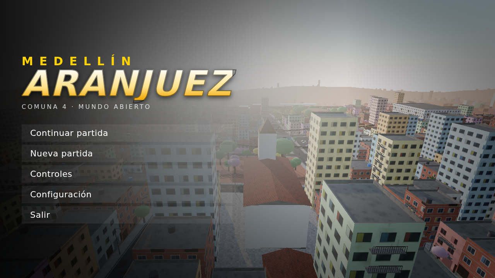
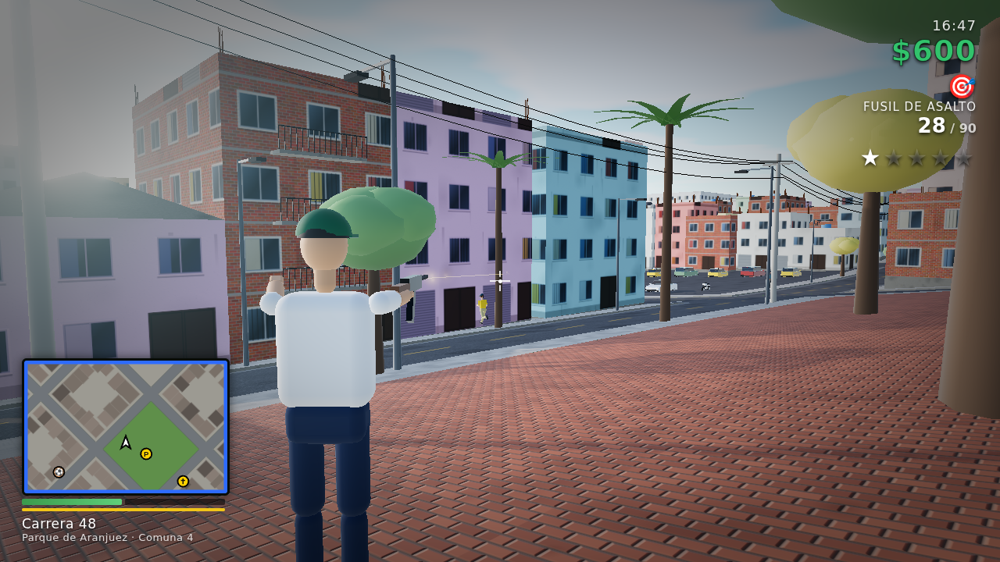
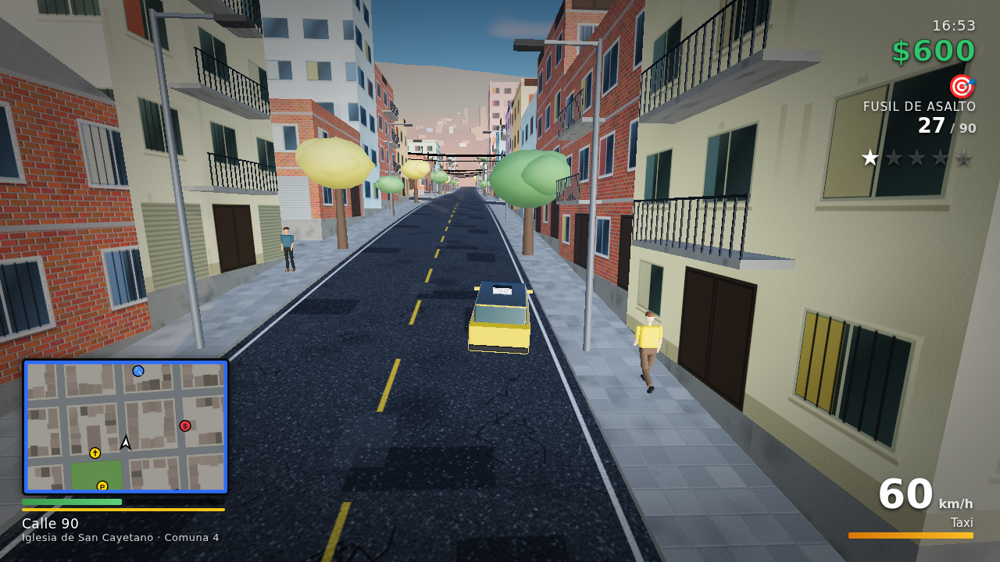
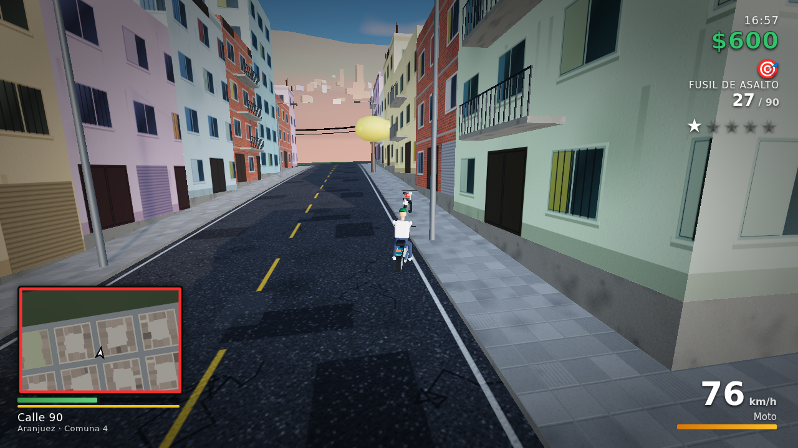
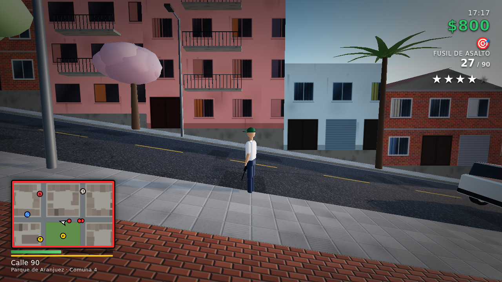
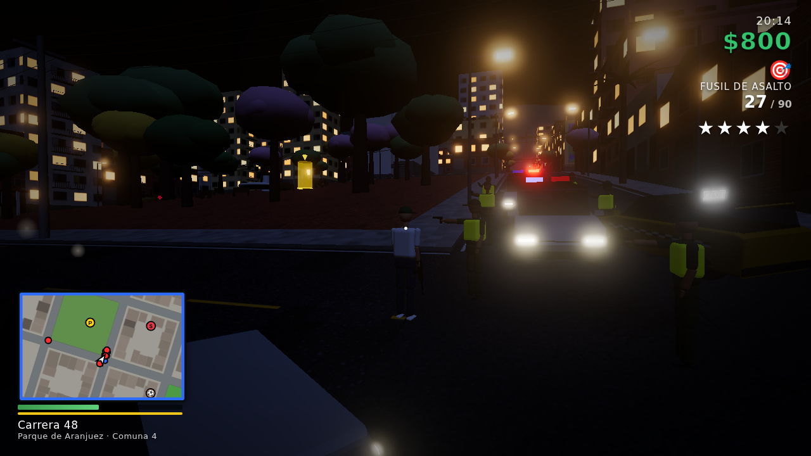
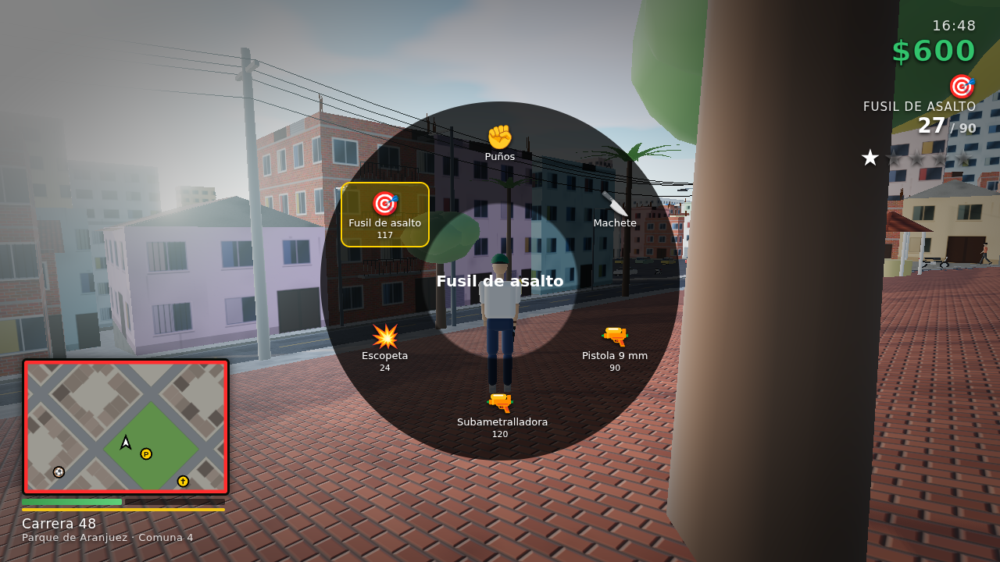
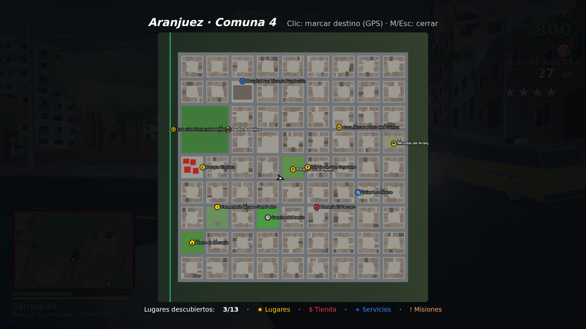

# Medellín: Aranjuez

Juego de mundo abierto en tercera persona inspirado en el barrio **Aranjuez (Comuna 4, Medellín)**. Es un MVP para escritorio **Windows 11** hecho con Three.js (WebGL 2) y empaquetado con Electron.

> El barrio es una recreación libre, no un plano exacto. Todo el contenido (texturas, modelos, sonido) se genera por código al arrancar: el juego no usa assets externos.

## Capturas (del juego corriendo)

| | |
|---|---|
|  |  |
|  |  |
|  |  |
|  |  |

Generadas con `npm run shots` (render por software en calidad Media; en una GPU real se ve igual pero a 60 FPS).

## Qué incluye el MVP

| Área | Contenido |
|---|---|
| **Mundo** | Ladera de ~630 × 630 m con calles empinadas (hasta 21 %), 81 manzanas y ~1.300 edificaciones: ladrillo a la vista, casas pintadas, locales con persiana, torres, terrazas con tanques de agua y varillas, balcones con reja, murales, postes con cableado aéreo, faroles y guayacanes. De fondo, el valle de Aburrá con miles de casas que se encienden de noche y el río Medellín. |
| **Horizonte del valle** | Las montañas que rodean Medellín hasta ~34 km, con alturas reales: la cordillera occidental (~2.700-3.000 m, Padre Amaya), la ladera oriental que sube a Santo Domingo y Arví, El Volador, Nutibara y el Quitasol al norte. Lomos y cañadas bajando al río, bosque y potrero, la ciudad trepando por las laderas y, de noche, el valle entero lleno de luces. Paralaje y oclusión correctos desde cualquier punto sin alargar la distancia de dibujo. |
| **Geografía real** | El orden de los lugares y los nombres de las vías salen de OpenStreetMap y el perfil del terreno de la elevación SRTM: Parque de Aranjuez sobre la Calle 92 (noreste), Casa Museo Pedro Nel Gómez en el centro, Moravia al oeste de la Carrera 52 (Carabobo) con su autoconstrucción en ladrillo, Explora y Botánico junto a la estación Universidad (Calle 73), Cementerio San Pedro y Hospital San Vicente al sur, y la ladera que sube hacia Manrique (Carrera 45). El mapa comprime ~1,7 × 2,5 km en 9 × 9 manzanas. |
| **Puntos de interés (13)** | Parque de Aranjuez, Iglesia San Nicolás, Casa Museo Pedro Nel Gómez, Jardín Botánico (con Orquideorama), Parque Explora, Estación Universidad del Metro (con tren en movimiento), Hospital San Vicente, Cementerio Museo San Pedro, Morro de Moravia, cancha del barrio, Mirador, Armería y Taller. Descubrir cada uno paga $100. |
| **Fachadas modeladas** | Cada casa tiene su propia fachada según su ancho y pisos: ventanas con marco de aluminio, vidrio reflectivo, alféizar, rejas (barrotes, rombos, abanico, cuadrícula) y cortinas; puerta aparte para subir al segundo piso, garajes y puertas metálicas; vigas y columnas de concreto a la vista, zócalo enchapado o pintado a dos tonos, tubería amarilla del gas, parabólicas, aleros de zinc, balcones con ropa colgada. Las culatas quedan en ladrillo a la vista. De noche se encienden ventanas una por una. |
| **Tiendas y calle** | Locales con cortina metálica a medio subir y el interior armado según el negocio, que se ve desde la calle: tienda de barrio (mostrador con vitrina de dulces, tiras de mecato colgadas, canastas de cerveza, nevera encendida, "Hoy no fío, mañana sí"), panadería, droguería (cruz verde), carnicería, frutería, barbería (sillas y espejos), ferretería, papelería (fotocopiadora), heladería, cafetería, billares (mesa con lámpara) y almacenes de ropa (maniquíes y percheros); piso de baldosa roja, granito o ajedrez y tubos fluorescentes que alumbran de noche. De lejos queda el cuarto pintado (sin utilería 3D). Vecinos sentados en sillas plásticas, venteros (minutos, frutas, mango biche, arepas, helados, dulces), placas de nomenclatura en las esquinas, paraderos y motos parqueadas en los andenes. |
| **Ropa paisa** | Cinco almacenes en la 92 y en Carabobo (Almacén Moda Paisa, Boutique Estilo La 92, Remates Carabobo, Deportes La Cancha, Gorras y Tenis La 52) venden gorras planas y curvas, busos con capota, camisetas (verdiblanca y roja de fútbol, sin escudos), jeans, sudaderas, tenis, chanclas con medias, cadena, canguro terciado y gafas. Lo comprado se ve en el personaje (recoloreado de la ropa y mallas pegadas a los huesos), se puede poner y quitar en cualquier almacén y queda en el guardado. |
| **Radio y música** | Al subirse a un carro o una moto suena la radio, como en GTA: cuatro emisoras inventadas con música libre de derechos (CC BY): **La Sabrosa 92.4** (salsa, cumbia, merengue), **Perreo FM 100.6** (reguetón y dancehall), **Parce Radio 97.8** (guaracha, moombahton y electrónica) y **Chill Comuna 4 88.2** (lo-fi). <kbd>Q</kbd> / <kbd>Z</kbd> (cruceta ← → en el mando) cambian de emisora o la apagan; la elección se recuerda. Cada emisora va "en vivo" (al volver no arranca de cero), cada pista muestra título, artista y licencia, la música baja sola cuando alguien habla o hay una cinemática, se pausa con el juego y calla en los menús, y tiene su propio volumen en Configuración. Billares, fritangas y algunas tiendas y mesas de dominó tienen un parlante que se oye bajito de cerca (máximo dos a la vez). Autores y licencias en [ASSETS-CREDITS.md](ASSETS-CREDITS.md#música-de-la-radio) y en la pantalla de créditos. |
| **Sonido del barrio** | Sintetizado en vivo: cumbia saliendo de la tienda más cercana, pájaros de día, grillos de noche, perros a lo lejos, campanas de la iglesia cada hora, motor con cambios y chirrido de llantas. |
| **Movilidad a pie** | Caminar, trotar, correr con estamina, agacharse, saltar, subir andenes y pendientes, colisiones sin atravesar paredes aunque el framerate caiga. |
| **Animaciones** | 75 clips de captura de movimiento de Microsoft Rocketbox (MIT, mismo esqueleto que los personajes): para subirse al carro el personaje camina a la puerta, la abre, se sienta de lado y se desliza al puesto (y al bajarse se levanta por la puerta; en moto pasa la pierna por encima), todo adelantable acelerando o caminando; al comprar recibe lo pedido y se lo come o se lo toma (con vaso en la mano); herido cojea; quieto un rato mira alrededor, se rasca o bosteza; <kbd>G</kbd> saluda, celebra, aplaude o baila. En la calle: vecinos sentados que gesticulan cuando hablan y asienten cuando escuchan, peatones con el celular (llamando o escribiendo), venteros que llaman con la mano, pandilleros que caminan sobrados y rumberos de noche. Cada peatón tiene su propia forma de estar quieto, gira en el sitio dando pasos (sin patinar), se inclina en las curvas al correr y voltea la cabeza para mirarte cuando pasas cerca. |
| **Vida de barrio** | Cerca del jugador aparece gente haciendo lo de todos los días: señoras colgando la ropa en el balcón (sacan la prenda del platón y la cuelgan en la cuerda), vecinos fumando recostados a la fachada (cigarrillo con brasa que se ve de noche y bocanadas de humo) o hablando por celular junto a la puerta, gente barriendo el andén, cuatro jugando dominó en una mesa plástica frente a la tienda, el que lava la moto con balde y trapo, y el **picadito**: en las canchas (con arquero), en las placas con arquitos y en calles residenciales tranquilas con piedras de arco, con balón que rebota y rueda, pases, remates, goles celebrados y la pausa para dejar pasar los carros; al jugador también le dejan patear el balón. Todos se asustan con los disparos y salen corriendo (la del balcón se entra a la casa). Solo se ponen en escena los más cercanos, con un cupo de personas por calidad. |
| **Vehículos (6 tipos)** | Taxi amarillo, sedán, camioneta, buseta, patrulla de la Policía y moto. Física de aceleración, frenado, reversa, freno de mano con derrape, pendientes, choques con daño, fuego y explosión. Se pueden robar con el conductor adentro. El agarre es limitado: a alta velocidad el carro subvira, los derrapes conservan el impulso y se corrigen con contravolante, el freno de mano suelta la cola, la carrocería cabecea y se balancea, y quedan marcas de llanta y humo. |
| **Armas (6)** | Puños, machete, pistola 9 mm (Beretta 92), subametralladora (HK MP5), escopeta (Remington 870) y fusil (M4A1): modelos reales con texturas PBR, sostenidos con las dos manos. Selección con 1–6, rueda del ratón o rueda de armas (Tab, con cámara lenta). Cargador, reserva, recarga, dispersión, retroceso, disparos a la cabeza y disparos desde el vehículo. |
| **NPCs** | Peatones que caminan por los andenes, cruzan en las esquinas y huyen de los disparos; tráfico que respeta el carril derecho y frena ante obstáculos; policía que te busca de verdad (ver abajo); pandilla hostil en misión. |
| **Policía** | Solo sabe dónde estás si un agente te ve (línea de vista: 85 m desde la patrulla, 65 m a pie; de cerca te oyen) o si alguien reporta un delito. Persigue por la ruta más corta; si te pierde, acude a tu última posición conocida y barre la **zona de búsqueda** (círculo rojo/azul en el minimapa, que crece y se corre hacia donde ibas) repartiéndose las calles entre patrullas; algunos agentes se bajan a buscarte a pie. Escondido dentro de la zona las estrellas bajan más lento que fuera de ella. |
| **Jugabilidad** | Nivel de búsqueda de 0 a 5 estrellas, 8 misiones (domicilio contrarreloj, pique en moto por checkpoints, "limpiar el parche", domicilios de mandingas en moto, el granizado que se derrite, el domiciliario de Las Patatas, buñuelos pa la novena y fotos del barrio), locales típicos donde se come para recuperar salud (Mandingas La 92 y La 94, Granizados La 92, Las Patatas, Panadería Los Marinillos, La Varaka, El Migao, arepas de chócolo, cholados, fritanga…), armería, hospital, taller, recogibles de plata/munición/salud/chaleco, ciclo día-noche, GPS en el minimapa y mapa completo con destino por clic, guardado automático. |
| **Noche** | Los faroles más cercanos alumbran de verdad (8 luces en Alta, 12 en Ultra, sin tirones al anochecer), los faros del carro del jugador son un foco real y todo el tráfico proyecta su luz en el asfalto; locales, avisos y ventanas encendidos. |
| **Cielo** | Dispersión atmosférica física (Preetham) horneada en una textura pequeña que solo se rehace cuando el sol se mueve (~0,35°), así el cielo cuesta una lectura de textura por píxel en vez de todo el modelo. Nubes por capas de ruido precalculado que se mueven con el viento: mañanas despejadas con cirros, cúmulos que crecen hacia la tarde (la más nublada, como en Medellín) y se abren de noche; bordes plateados a contraluz y sombra propia. Disco y halo del sol que se enrojecen al atardecer (hora dorada ~6 p. m.), luna llena que sale por la montaña, estrellas tenues y el resplandor anaranjado de la ciudad en la bruma. El horizonte se funde con la misma niebla de las montañas; los reflejos del atardecer y la noche salen de la misma textura. En calidad Baja, textura más pequeña y una sola capa de nubes. |
| **Pájaros** | Palomas en parques y plazas que caminan y picotean, y arrancan a volar todas juntas si llegas corriendo, pasa un carro o suena un tiro (dan vueltas sobre la plaza y vuelven a bajar); gallinazos planeando en espiral en las térmicas, muy alto, de día; bandadas de loros que cruzan gritando al amanecer y al atardecer. Unas decenas como máximo en una sola malla instanciada, con el aleteo en el sombreador; sonidos sintetizados (aleteo, zureo, chillidos). |
| **Gráficos** | Iluminación física (PBR), cielo atmosférico, sombras suaves, reflejos del cielo, oclusión ambiental (N8AO en Alta y Ultra), bloom, SMAA, gradación de color y 4 niveles de calidad. |
| **HUD y menús** | HUD sobrio: tipografía condensada (Barlow), paneles oscuros, siluetas reales de las armas, estrellas en vector, minimapa oscuro con brújula, barra de recarga, viñeta roja con poca salud, velocímetro en panel. Configuración con **brillo** y **pantalla completa** (también F11; en la app de escritorio se recuerda entre sesiones). Pantalla de **créditos** con todos los autores. |
| **Rendimiento** | Pensado para 60 FPS: nivel de detalle por árbol/poste, personajes y conductores lejanos sin dibujar, sombras solo de cerca, ~500-800 llamadas de dibujo por frame en Alta, **resolución dinámica** (baja la resolución interna si un frame pasa de ~18 ms), precalentado de shaders en la carga y calidad Baja automática si WebGL corre por software. El contador de FPS (Configuración) muestra la escala de resolución y la pausa, la GPU detectada. |

### Sobre los "gráficos hiperrealistas"
Un nivel de detalle como el de GTA V/VI requiere miles de modelos y texturas hechas por artistas y un motor como Unreal. Este MVP usa un pipeline realista (PBR, sombras, AO, iluminación atmosférica) sobre geometría procedural, así que se ve moderno pero **no fotorrealista**. El código está preparado para reemplazar las piezas procedurales por modelos glTF y texturas fotográficas cuando existan.

## Instalar en Windows 11

1. Descarga el artefacto **MedellinAranjuez-Windows** del flujo de GitHub Actions *Medellín Aranjuez* (pestaña **Actions** del repositorio, última ejecución).
2. Elige una opción:
   - `MedellinAranjuez-Setup-<versión>.exe`: instalador con acceso directo en el escritorio y el menú Inicio.
   - `MedellinAranjuez-Portable-<versión>.exe`: se ejecuta sin instalar.
   - `MedellinAranjuez-<versión>-win-x64.zip`: descomprime y abre `MedellinAranjuez.exe`.
3. Como el ejecutable no está firmado, Windows SmartScreen puede avisar: **Más información → Ejecutar de todas formas**.

Requisitos: Windows 10/11 de 64 bits y una GPU con WebGL 2 (cualquier integrada reciente sirve en calidad Media; se recomienda una GPU dedicada para Alta/Ultra).

## Controles

| Acción | Teclado y ratón | Mando Xbox |
|---|---|---|
| Moverse / cámara | WASD / ratón | LS / RS |
| Correr · caminar · agacharse | Shift · Alt · C o Ctrl | L3 · — · B |
| Saltar | Espacio | A |
| Apuntar · disparar | Clic derecho · clic izquierdo | LT · RT |
| Recargar | R | X |
| Cambiar arma | 1–6, rueda del ratón, Tab (rueda de armas) | LB / RB |
| Subir, bajar o robar vehículo | F | Y |
| Acelerar · frenar/reversa · freno de mano | W · S · Espacio | RT · LT · B |
| Pito · mirar atrás | H · C | L3 |
| Radio: emisora siguiente · anterior (en vehículo) | Q · Z | Cruceta → · ← |
| Interactuar (tiendas, misiones) | E | Cruceta ↑ |
| Gestos (saludar, celebrar, aplaudir, bailar) | G | Cruceta ↓ |
| Mapa · cámara · pausa | M · V · Esc | View · R3 · Menu |
| Cambiar de hombro (a pie) | X | Cruceta ← |

**Cámara.** A pie, <kbd>V</kbd> recorre normal / lejos / cerca (y primera persona si se activa en Configuración); <kbd>X</kbd> pasa la cámara al otro hombro (también al apuntar). En vehículo, <kbd>V</kbd> recorre cerca / lejos / capó (en moto, sobre el hombro). En Configuración: vista inicial en vehículo, suavizado de la cámara (0 % rígida … 100 % muy suave) y primera persona a pie. La cámara nunca atraviesa paredes: se acerca, vuelve al centro si el hombro choca con un muro y en primera persona no pasa del muro de enfrente.

## Desarrollo

```bash
npm install
npm run dev          # navegador en http://localhost:5173
npm start            # app de escritorio (Electron)
npm test             # pruebas unitarias (Vitest)
npm run test:e2e     # pruebas de extremo a extremo en Chromium (Playwright)
npm run dist:win     # instalador + portable + zip para Windows (desde Windows)
npm run dist:win:zip # zip de Windows (funciona desde Linux/macOS sin wine)
npm run shots        # capturas reales de una sesión guionizada en shots/
```

### Estructura

```
src/sim/      Lógica pura y testeable: terreno, ciudad, colisiones, jugador,
              vehículos, armas, balística, peatones, tráfico, misiones, policía
src/render/   Three.js: texturas procedurales, ciudad, cielo, personajes,
              vehículos, efectos y postprocesado
src/game/     Orquestación: bucle, entrada, audio, mundo vivo, combate, cámara
src/ui/       HUD, minimapa/GPS, rueda de armas y estilos
electron/     Proceso principal y preload de la app de escritorio
tests/unit/   Pruebas de la simulación (Vitest)
tests/e2e/    Pruebas del juego real con teclado y ratón (Playwright)
```

### Pruebas

- **Unitarias (Vitest)**: generación determinista de la ciudad, accesibilidad de los puntos de interés, colisiones, movilidad a pie (velocidades, estamina, salto, paredes a cualquier framerate, andenes y pendientes), física de cada vehículo (0–100, frenado, giro, derrape, lomas, choques), tráfico autónomo circulando 3 minutos por el barrio sin salirse de la vía, persecución policial, peatones en andenes y huyendo, armas (cadencia, cargador, recarga, cambio, dispersión, daño), balística, misiones, cámara (hombro, primera persona, colisión, suavizado), cielo (sol y luna por hora, dispersión, nubosidad, ruido sin costuras) y pájaros (palomas que se espantan y vuelven, gallinazos, loros).
- **Extremo a extremo (Playwright)**: arranca el juego real y lo maneja con teclado y ratón: caminar, correr, saltar, cambiar de arma, disparar y recargar, subirse al taxi y a la moto, descubrir un lugar, completar una misión, comprar y ponerse ropa, activar la policía, morir y reaparecer, pausar.
- **Capturas de vitrinas**: `npx vite build && node scripts/tiendas.mjs <carpeta>` fotografía los locales de día y de noche (y al jugador con otra pinta) y anota llamadas de dibujo y triángulos.
- **Prueba de humo del .exe**: en CI se abre el ejecutable empaquetado en Windows, se entra a jugar y se guarda una captura.
